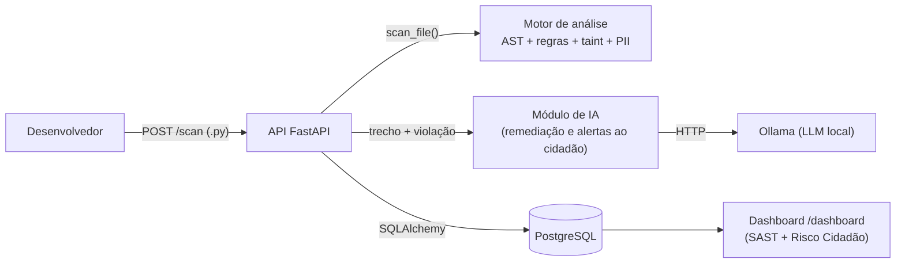
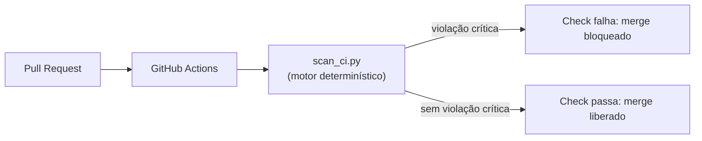
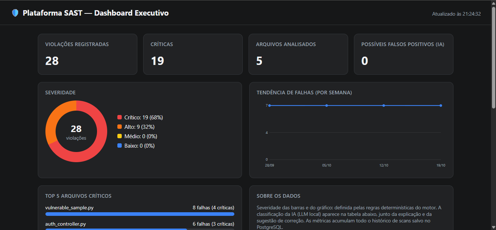
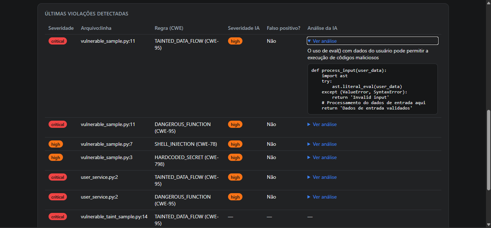
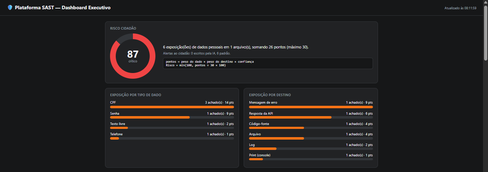
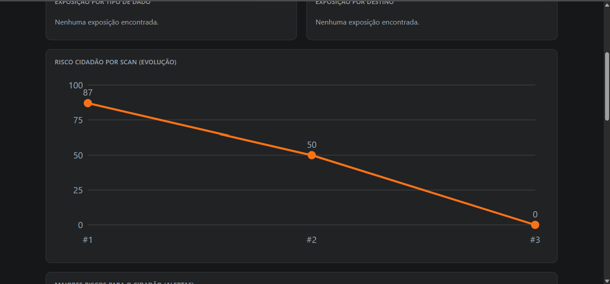

# Plataforma SAST & DevSecOps

Projeto Integrador — Engenharia de Software (FIAP).

Plataforma de **Static Application Security Testing (SAST)** que analisa código-fonte Python **sem executá-lo**, detecta vulnerabilidades por meio de uma Árvore de Sintaxe Abstrata (AST) e de análise de fluxo de dados (*taint analysis*), usa um **LLM local (Ollama)** para classificar a severidade e sugerir correções, e se integra ao pipeline **CI/CD (GitHub Actions)** como um *Security Gate* que bloqueia Pull Requests com falhas críticas.

- **Linguagem-alvo analisada:** Python
- **Repositório:** https://github.com/wendelldsant/sast-devsecops-platform
- **Extensão GS CitizenTech (Cybersecurity):** a plataforma foi estendida com detecção de PII, taint analysis de PII, alertas ao cidadão via IA e o indicador **Risco Cidadão**, aplicados ao protótipo "Zeladoria do Bairro". Veja a [seção 15](#15-extensão-gs-citizentech-cybersecurity-zeladoria-do-bairro) e o [mapa da entrega](ENTREGA_CYBERSECURITY.md).

### Alunos envolvidos

| Aluno | RM | GitHub |
|---|---|---|
| Augusto Rocha Silva | RM556316 | [augustorocha27](https://github.com/orgs/FIAP-3ESR-2026/people/augustorocha27) |
| Erik Yuuta Goto | RM558076 | [erikgotoo](https://github.com/orgs/FIAP-3ESR-2026/people/erikgotoo) |
| Guilherme Vieira Augusto | RM557264 | [guiaugustou](https://github.com/orgs/FIAP-3ESR-2026/people/guiaugustou) |
| Wendell dos Santos Silva | RM558859 | [wendelldsant](https://github.com/orgs/FIAP-3ESR-2026/people/wendelldsant) |

---

## Sumário

1. [Funcionalidades](#1-funcionalidades)
2. [Arquitetura](#2-arquitetura)
3. [Stack e justificativas](#3-stack-e-justificativas)
4. [Como executar](#4-como-executar)
5. [Usando a plataforma](#5-usando-a-plataforma)
6. [Motor de análise](#6-motor-de-análise)
7. [Módulo de IA](#7-módulo-de-ia)
8. [DevSecOps: Security Gate](#8-devsecops-security-gate)
9. [Dashboard](#9-dashboard)
10. [Estrutura do projeto](#10-estrutura-do-projeto)
11. [Decisões de projeto](#11-decisões-de-projeto)
12. [Limitações conhecidas e melhorias futuras](#12-limitações-conhecidas-e-melhorias-futuras)
13. [Ética e uso responsável](#13-ética-e-uso-responsável)
14. [Mapeamento com os critérios de avaliação](#14-mapeamento-com-os-critérios-de-avaliação)
15. [Extensão GS CitizenTech: Cybersecurity](#15-extensão-gs-citizentech-cybersecurity-zeladoria-do-bairro)

---

## 1. Funcionalidades

| Funcionalidade | Descrição |
|---|---|
| Parser AST | Transforma o código Python em árvore de sintaxe usando o módulo `ast` e a percorre com `ast.NodeVisitor` |
| Regras determinísticas | Detecta `eval`/`exec`, segredos hardcoded e `shell=True` em chamadas de subprocesso |
| Taint analysis | Rastreia dados não confiáveis (parâmetros e `input()`) até funções sensíveis, com reconhecimento de sanitização básica |
| Módulo de IA | LLM local classifica severidade, indica possível falso positivo, explica o risco e sugere correção |
| API REST | `POST /scan` recebe um arquivo `.py` e devolve as violações em JSON |
| Persistência | Cada violação é salva no PostgreSQL, formando o histórico usado pelo dashboard |
| Dashboard | Severidade, tendência de falhas, arquivos críticos e análise da IA |
| Security Gate | GitHub Actions executa o scanner a cada Pull Request e bloqueia o merge com falhas críticas |
| Detecção de PII *(GS)* | Encontra CPF (com dígito verificador), telefone, e-mail, senha e dados de saúde em texto e em literais de código, com confiança alta ou média |
| Taint de PII *(GS)* | Rastreia dado pessoal da fonte até log, `print`, arquivo, exceção e resposta da API, reconhecendo `mask_pii()` como sanitizador |
| Alertas ao cidadão *(GS)* | O LLM local traduz cada falha em um alerta claro de risco; a saída é validada e há alerta-padrão de segurança |
| Risco Cidadão *(GS)* | Indicador de 0 a 100 no dashboard, com exposição por tipo e destino e evolução por scan |

---

## 2. Arquitetura

Os diagramas C4 (Contexto e Container) estão em [`docs/architecture-c4.md`](docs/architecture-c4.md).

Fluxo de um scan via API:



Fluxo no CI/CD:



Containers (Docker Compose):

| Serviço | Imagem | Função |
|---|---|---|
| `api` | Build local (`python:3.11-slim`) | API FastAPI, motor de análise, cliente de IA e dashboard |
| `db` | `postgres:16` | Persistência do histórico de violações |

O Ollama roda **no host** (fora dos containers) e é acessado pela API via `host.docker.internal`.

---

## 3. Stack e justificativas

| Camada | Tecnologia | Por quê |
|---|---|---|
| Parsing | `ast` (biblioteca padrão) | AST nativa e completa para Python, sem dependências externas |
| API | FastAPI + Uvicorn | Rotas simples, validação automática e documentação em `/docs` |
| Banco | PostgreSQL + SQLAlchemy | Consultas agregadas para o dashboard; ORM evita SQL manual |
| IA | Ollama (`llama3.2:3b`) | LLM local: o código analisado não sai da máquina |
| Containerização | Docker + Docker Compose | Ambiente reproduzível com um comando |
| CI/CD | GitHub Actions | Integrado ao repositório; bloqueio de PR via checks obrigatórios |

---

## 4. Como executar

### Pré-requisitos

- Docker Desktop (Compose v2)
- [Ollama](https://ollama.com/download) instalado, com o modelo baixado:
  ```bash
  ollama pull llama3.2:3b
  ```
  O Ollama é necessário apenas para os scans **com IA**. Scans com `use_ai=false` funcionam sem ele.

### Passos

```bash
git clone https://github.com/wendelldsant/sast-devsecops-platform.git
cd sast-devsecops-platform

cp .env.example .env
```

Edite o `.env` e preencha os valores. Exemplo para desenvolvimento local:

```env
POSTGRES_USER=sast_user
POSTGRES_PASSWORD=defina_uma_senha
POSTGRES_DB=sast_db
DATABASE_URL=postgresql://sast_user:defina_uma_senha@db:5432/sast_db
OLLAMA_URL=http://host.docker.internal:11434
OLLAMA_MODEL=llama3.2:3b
```

A senha em `DATABASE_URL` deve ser igual à de `POSTGRES_PASSWORD`. O arquivo `.env` **não é versionado**.

```bash
docker compose up --build
```

| Recurso | URL |
|---|---|
| Documentação interativa da API | http://localhost:8000/docs |
| Health check | http://localhost:8000/health |
| Dashboard | http://localhost:8000/dashboard |

> Se a API não alcançar o Ollama (`Connection refused`), defina a variável de ambiente `OLLAMA_HOST=0.0.0.0` no sistema e reinicie o Ollama.

### Atualização de schema

`Base.metadata.create_all()` cria tabelas inexistentes, mas **não altera** tabelas já criadas. Em um banco criado antes da integração com IA, adicione as colunas manualmente:

```sql
ALTER TABLE scan_results
  ADD COLUMN ai_severity VARCHAR,
  ADD COLUMN ai_false_positive BOOLEAN,
  ADD COLUMN ai_explanation TEXT,
  ADD COLUMN ai_remediation TEXT;
```

As colunas e a tabela da extensão GS (`scan_runs`, `scan_id`, `pii_type`, `sink`, `confidence` e `alert_*`) são criadas automaticamente na subida da API por `ensure_columns()` (migração idempotente).

### Testes automatizados

```bash
pip install -r requirements-dev.txt
python -m pytest tests -v
```

São 120 testes (PII, taint de PII, alertas ao cidadão, API e dashboard). Os testes de API usam SQLite temporário, nunca o banco real.

---

## 5. Usando a plataforma

### Scan via API

```bash
# Com análise da IA (mais lento: uma chamada ao LLM por violação)
curl -X POST "http://localhost:8000/scan" -F "file=@tests/vulnerable_sample.py"

# Apenas motor determinístico (rápido)
curl -X POST "http://localhost:8000/scan?use_ai=false" -F "file=@tests/vulnerable_sample.py"
```

Exemplo de resposta (resumida):

```json
{
  "filename": "vulnerable_sample.py",
  "issues_found": 4,
  "issues": [
    {
      "rule_id": "DANGEROUS_FUNCTION",
      "cwe": "CWE-95",
      "message": "Uso perigoso de 'eval()' pode permitir execução de código arbitrário.",
      "line": 11,
      "severity": "critical",
      "ai_severity": "high",
      "ai_false_positive": false,
      "ai_explanation": "...",
      "ai_remediation": "..."
    }
  ]
}
```

### Scan de código com dados pessoais (extensão GS)

```bash
curl -X POST "http://localhost:8000/scan?use_ai=false" \
  -F "file=@tests/prototipo_zeladoria/vulneravel.py;filename=zeladoria_api.py"
```

Além das violações, a resposta traz o Risco Cidadão da execução e, em cada achado de PII, o tipo, o destino e o alerta ao cidadão (resumida):

```json
{
  "filename": "zeladoria_api.py",
  "issues_found": 6,
  "citizen_risk": { "score": 87, "nivel": "critico", "pontos": 26.0 },
  "issues": [
    {
      "rule_id": "PII_LEAK",
      "cwe": "CWE-209",
      "severity": "critical",
      "line": 48,
      "pii_type": "SENHA",
      "sink": "excecao",
      "confidence": "alta",
      "message": "Dado pessoal (SENHA) chega a 'HTTPException()' sem sanitização. Fluxo: ...",
      "citizen_alert": {
        "titulo": "Sua senha pode ficar exposta",
        "risco": "...",
        "o_que_fazer": "...",
        "nivel": "critico",
        "pontos": 9,
        "fonte": "padrao"
      }
    }
  ]
}
```

O valor do dado pessoal nunca aparece na resposta, só os nomes de campos e variáveis do fluxo.

### Scan via linha de comando (sem API, sem banco)

```bash
python scan_ci.py . --exclude tests --exclude scripts/validar_pii.py --fail-on critical
```

Retorna código de saída `1` se houver violação na severidade informada ou acima, e `0` caso contrário. Gera o relatório `sast-report.json`.

### Consultar o histórico no banco

```bash
docker compose exec db psql -U sast_user -d sast_db \
  -c "SELECT filename, rule_id, severity, ai_severity, line FROM scan_results ORDER BY id DESC LIMIT 10;"
```

---

## 6. Motor de análise

O motor possui camadas complementares, implementadas sobre a mesma AST:

1. **Regras sintáticas** (`app/engine/rules.py`): padrões perigosos isolados.
2. **Taint analysis** (`app/engine/taint.py`): fluxo de dados não confiáveis até funções sensíveis.
3. **Detecção de PII** (`app/pii/`, extensão GS): dados pessoais em texto livre e em literais de código.
4. **Taint analysis de PII** (`app/engine/pii_taint.py`, extensão GS): fluxo de dado pessoal até saídas inseguras.

As duas primeiras camadas podem sinalizar a mesma linha (por exemplo, um `eval(x)` com `x` vindo de parâmetro) por motivos diferentes: a primeira porque a função é perigosa por natureza, a segunda porque comprovou que a entrada não foi tratada.

### Regras

| Regra | CWE | Severidade | Detecta |
|---|---|---|---|
| `DANGEROUS_FUNCTION` | CWE-95 | critical | Chamadas a `eval()` e `exec()` |
| `HARDCODED_SECRET` | CWE-798 | high | Atribuição de string literal a variáveis como `password`, `senha`, `secret`, `api_key`, `token` |
| `SHELL_INJECTION` | CWE-78 | high | `run`/`call`/`Popen` com `shell=True` |
| `TAINTED_DATA_FLOW` | CWE-95 / CWE-78 | critical | Dado não confiável chegando a um *sink* sem sanitização |
| `PII_HARDCODED` *(GS)* | CWE-359 / CWE-798 | high (CPF, senha) ou medium (telefone, e-mail) | CPF, telefone, e-mail ou senha em literais de texto do código (docstrings são ignoradas) |
| `PII_LEAK` *(GS)* | CWE-532 / 312 / 209 / 200 | critical | Dado pessoal chegando a log, `print`, arquivo, exceção ou resposta de rota sem passar por `mask_pii()` |

### Taint analysis

- **Fontes (sources):** parâmetros da função e retorno de `input()`.
- **Destinos sensíveis (sinks):** `eval()`, `exec()`, `os.system()`, `os.popen()`.
- **Propagação:** atribuições simples entre variáveis (`b = a`).
- **Sanitização reconhecida:** conversão explícita de tipo (`int()`, `float()`, `bool()`). A variável deixa de ser considerada contaminada.
- **Escopo:** análise **intra-função**; cada função é analisada isoladamente.

### Detecção de PII e taint de PII (extensão GS)

Resumo (detalhes em [`docs/cyber/etapa1-pii.md`](docs/cyber/etapa1-pii.md) e [`docs/cyber/etapa2-taint.md`](docs/cyber/etapa2-taint.md)):

- **Detectores:** CPF (dígito verificador módulo 11, rejeita sequências repetidas), telefone brasileiro (DDD válido), e-mail, senha (palavra-chave e valor) e saúde (léxico com contexto pessoal e códigos CID). Cada achado tem confiança `alta` ou `media`.
- **Mascaramento:** `mask_pii()` troca cada PII por uma etiqueta (`[CPF]`, `[TELEFONE]`...), é idempotente e é o sanitizador reconhecido pelo taint.
- **Taint de PII:** fontes por nome de campo (`cpf`, `telefone`, `email`, `senha`, `descricao`...); propagação por atribuição, f-string, concatenação, `.format()`, dict, lista, loops e chamadas (função desconhecida mantém o taint com confiança `media`); sinks: `logging.*`, `print`, escrita em arquivo, exceção e `return` de rota FastAPI; análise intra-função, inclusive `async def`.
- **Relatório sem PII:** cada achado mostra o fluxo (por exemplo, `ocorrencia.telefone (L31) → contato (L31) → print() (L32)`), nunca o valor do dado.

---

## 7. Módulo de IA

Para cada violação, a API envia ao Ollama (`/api/generate`, `format: json`, `temperature: 0.1`) o trecho de código ao redor da linha suspeita (marcada com `>>>`) e recebe:

| Campo | Significado |
|---|---|
| `ai_severity` | Severidade segundo o LLM (`critical`, `high`, `medium`, `low`) |
| `ai_false_positive` | Se o LLM considera a violação um possível falso positivo |
| `ai_explanation` | Explicação curta do risco |
| `ai_remediation` | Sugestão de código corrigido |

Decisões relevantes:

- **Orientação por regra (`RULE_HINTS`):** cada tipo de violação recebe uma dica determinística de correção no prompt, o que reduz correções inventadas por um modelo pequeno.
- **Resiliência:** se o Ollama estiver indisponível, demorar além do timeout ou devolver JSON inválido, a análise de IA é descartada (e registrada em log) e o scan continua com os resultados das regras.
- **Saída do LLM tratada como dado não confiável:** o código analisado é de terceiros e pode tentar manipular o modelo (*prompt injection*). A severidade é validada contra uma lista fixa e a remediação é apenas armazenada como texto, nunca executada. No dashboard, todo texto é exibido com `textContent`.
- **Severidade da regra vs. severidade da IA:** ficam em colunas separadas. A decisão de bloqueio do Security Gate usa a severidade **das regras** (determinística e reproduzível); a da IA é informativa.

### Alertas ao cidadão (extensão GS)

A extensão GS usa o mesmo Ollama para uma segunda tarefa: traduzir cada achado técnico em um alerta claro de risco para o morador (`app/ai/citizen_alert.py`).

- **Privacidade:** o prompt contém só categorias (tipo de dado e destino), nunca trecho de código, nomes de variáveis ou valores. Achados de PII não enviam trecho de código ao LLM.
- **Saída validada:** restrita por JSON schema e checada quanto a formato, tamanho, jargão, ausência de PII, coerência com o dado e o destino reais e consequências inventadas. Se falhar, entra um alerta-padrão determinístico; o campo `fonte` registra `ia` ou `padrao`.
- **Quem decide o risco:** o nível vem de pesos fixos (`app/risk.py`), não do modelo. O título é fixo por tipo de dado e o alerta por categoria fica em cache.
- **Teste real:** o `llama3.2:3b` errou o destino, o gênero e inventou consequências; a validação foi criada a partir disso. Detalhes em [`docs/cyber/etapa3-ia.md`](docs/cyber/etapa3-ia.md).

---

## 8. DevSecOps: Security Gate

Workflow: [`.github/workflows/security-gate.yml`](.github/workflows/security-gate.yml)

A cada Pull Request para a `main` (e a cada push na `main`):

1. O GitHub Actions faz o checkout e configura o Python 3.11.
2. Executa `python scan_ci.py . --exclude tests --exclude scripts/validar_pii.py --fail-on critical`.
3. Se houver violação **crítica**, o job falha (`exit code 1`) e o check `sast-scan` fica vermelho.
4. Publica o relatório `sast-report.json` como artefato e um resumo em tabela na aba *Summary* do job.
5. As violações aparecem como **anotações nas linhas** do código, na aba *Files changed* do PR.

A `main` é protegida: o check `sast-scan` é **obrigatório**, então um PR com falha crítica não pode ser mesclado.

Escolhas de projeto:

- O CI usa apenas o motor determinístico (sem Ollama nem banco), por ser rápido e reproduzível, e porque o runner não tem o LLM local.
- O pipeline usa `permissions: contents: read` (princípio do menor privilégio).
- A pasta `tests/` é excluída do gate porque contém amostras vulneráveis **de propósito**, usadas para validar o scanner. O script `scripts/validar_pii.py` também é excluído por conter CPFs e telefones fictícios de teste. Um PR que vaza PII é reprovado, pois `PII_LEAK` é `critical`.

### Evidências

| Evidência | Arquivo |
|---|---|
| Gate aprovando código limpo | [08-gate-aprovado-log.png](docs/evidencias/08-gate-aprovado-log.png) |
| PR reprovado pelo gate | [01-gate-reprovado.png](docs/evidencias/01-gate-reprovado.png) |
| Log do scanner reprovando (`exit code 1`) | [02-gate-reprovado-log.png](docs/evidencias/02-gate-reprovado-log.png) |
| Merge bloqueado pelo check obrigatório | [03-gate-reprovado-merge-blocked.png](docs/evidencias/03-gate-reprovado-merge-blocked.png) |
| Anotações nas linhas do PR | [04](docs/evidencias/04-gate-reprovado-code-checks.png), [05](docs/evidencias/05-gate-reprovado-code-checks.png) |
| Regra de proteção da `main` | [06](docs/evidencias/06-branch-protection-rules.png), [06 (config)](docs/evidencias/06-branch-protection-rules-config.png), [07 (config)](docs/evidencias/07-branch-protection-rules-config.png) |

---

## 9. Dashboard

Acesse `http://localhost:8000/dashboard`. Dados vêm de `GET /api/dashboard/summary` (SAST) e de `GET /api/dashboard/citizen-risk` (Risco Cidadão, extensão GS).

- Indicadores gerais: total de violações, críticas, arquivos analisados e possíveis falsos positivos segundo a IA.
- Distribuição por severidade.
- Tendência de falhas por semana.
- Top 5 arquivos com mais violações.
- Últimas violações, com a análise da IA expandível.
- **Risco Cidadão *(GS)*:** medidor de 0 a 100, exposição por tipo de dado e por destino, evolução por scan e tabela dos maiores riscos com os alertas ao cidadão (seção 15).

Implementado em HTML, CSS e SVG puros, sem dependências externas (funciona offline).




Para popular o dashboard com dados de exemplo:

```bash
for f in tests/vulnerable_sample.py tests/vulnerable_taint_sample.py tests/auth_controller.py \
         tests/db_config.py tests/user_service.py; do
  curl -s -X POST "http://localhost:8000/scan?use_ai=false" -F "file=@$f" > /dev/null
done
```

Para popular o Risco Cidadão (vulnerável → parcial → corrigido), use `python scripts/popular_dashboard.py`. Evite enviar os arquivos `tests/test_*.py` ao `/scan`: eles contêm CPFs fictícios de teste e elevariam o indicador.

---

## 10. Estrutura do projeto

```
sast-devsecops-platform/
├── app/
│   ├── api/
│   │   ├── main.py            # rotas /health e /scan
│   │   ├── dashboard.py       # /dashboard, /api/dashboard/summary e /api/dashboard/citizen-risk
│   │   ├── database.py        # conexão, sessão SQLAlchemy e ensure_columns()
│   │   ├── models.py          # tabelas scan_results e scan_runs
│   │   └── static/dashboard.html
│   ├── engine/
│   │   ├── parser.py          # orquestra o scan de um arquivo
│   │   ├── rules.py           # regras sintáticas (NodeVisitor) e PII_HARDCODED
│   │   ├── taint.py           # taint analysis intra-função
│   │   └── pii_taint.py       # taint analysis de PII (PII_LEAK)
│   ├── pii/
│   │   └── detectors.py       # detectores de PII e mask_pii()
│   ├── ai/
│   │   ├── ollama_client.py   # remediação de código com o LLM local
│   │   └── citizen_alert.py   # alertas ao cidadão (prompt, validação e alerta-padrão)
│   └── risk.py                # pontos de exposição e Risco Cidadão
├── tests/
│   ├── vulnerable_*.py ...    # amostras vulneráveis (fixtures)
│   ├── prototipo_zeladoria/   # protótipo vulnerável, parcial e corrigido
│   └── test_*.py              # 120 testes automatizados
├── scripts/                   # validação de PII, auditoria, alertas, dashboard e montagem do ZIP
├── docs/
│   ├── architecture-c4.md     # diagramas C4
│   ├── evidencias/            # prints do Security Gate e do dashboard
│   └── cyber/                 # documentação e evidências da extensão GS
├── .github/workflows/security-gate.yml
├── ENTREGA_CYBERSECURITY.md   # mapa da entrega de Cybersecurity (GS)
├── prompts.md                 # registro do uso de IA
├── scan_ci.py                 # CLI do Security Gate
├── scan_cli.py                # execução local simples do motor
├── docker-compose.yml
├── Dockerfile
├── requirements.txt
├── requirements-dev.txt
└── .env.example
```

---

## 11. Decisões de projeto

| Decisão | Motivo |
|---|---|
| Linguagem-alvo única (Python) com `ast` nativo | Reduz o escopo e concentra esforço em precisão (menos falsos positivos). O parser está desacoplado das regras |
| Sem Redis/Celery no MVP | Processamento síncrono é suficiente para o escopo; filas ficam como melhoria futura |
| Duas camadas de detecção (regras + taint) | Regras pegam padrões perigosos; taint comprova se a entrada realmente chega ao ponto sensível |
| Credenciais fora do versionamento (`.env`) | Evita o problema que a própria plataforma detecta (CWE-798) |
| Gate baseado em regras, IA apenas informativa | Decisão de bloqueio determinística e auditável |
| Histórico por violação (uma linha por achado) | Facilita agregações do dashboard |
| PII: precisão antes de cobertura *(GS)* | CPF só vale com dígito verificador; telefone só com DDD; "dengue" e "cadeirante" ficam de fora (relatos do bairro, não dado de uma pessoa) |
| Taint de PII com fonte por nome de campo e propagação conservadora *(GS)* | A análise estática não vê o conteúdo; alerta a mais é melhor que vazamento escondido, e a confiança separa certeza de suspeita |
| O LLM escreve, a regra decide o risco *(GS)* | O nível vem de pesos determinísticos; a saída do modelo é validada e há alerta-padrão |
| Risco Cidadão sobre o último scan de cada arquivo *(GS)* | Se somasse o histórico, corrigir o código nunca reduziria o risco; `scan_runs` registra scans sem achados |

---

## 12. Limitações conhecidas e melhorias futuras

**Limitações**

- **Multilinguagem:** o motor analisa apenas Python. O parser foi mantido desacoplado das regras para permitir a futura substituição por **Tree-sitter**, viabilizando JavaScript e Java sem reescrever as regras.
- **Taint analysis simplificada:** é intra-função (não rastreia dados entre funções ou módulos). A taint original (`taint.py`) só considera como sink argumentos que são variáveis simples e não analisa `async def` nem parâmetros *keyword-only*; a taint de PII (`pii_taint.py`) cobre f-strings, concatenação, atributos e `async def`.
- **Heurística de segredos:** baseada no nome da variável; não detecta segredos em variáveis com nomes genéricos nem por entropia.
- **Cobertura de regras:** três padrões de regra, PII e os dois fluxos de taint. Injeção de SQL, desserialização insegura e criptografia fraca não estão cobertas.
- **Qualidade da IA:** o modelo `llama3.2:3b` acerta o diagnóstico, mas as correções sugeridas nem sempre são válidas. Devem ser tratadas como **sugestão para revisão humana**.
- **Desempenho:** a chamada ao LLM é síncrona e feita por violação; em CPU, scans com muitas violações são lentos.
- **Migrações de banco:** as colunas da extensão GS são criadas automaticamente (`ensure_columns()`); as colunas de IA do CP2 continuam manuais.
- **Extensão GS:** a fonte do taint de PII é detectada pelo nome do campo e não há rastreio interprocedural; a detecção de saúde é heurística e foi validada em um conjunto pequeno e controlado; os pesos do Risco Cidadão são uma convenção do projeto (LGPD e alcance do destino); o `llama3.2:3b` exige validação e alerta-padrão.

**Melhorias futuras**

- Processamento assíncrono com Redis + Celery.
- Taint analysis interprocedural e reconhecimento de mais sources/sinks (frameworks web, SQL).
- Suporte a outras linguagens via Tree-sitter.
- Modelos maiores (basta alterar `OLLAMA_MODEL`).
- Migrações com Alembic.
- Autenticação nos endpoints da API.

---

## 13. Ética e uso responsável

A análise de código deve respeitar a propriedade intelectual e a privacidade do código-fonte. Neste projeto:

- Os arquivos em `tests/` são **amostras sintéticas** criadas para validar o scanner; não pertencem a terceiros.
- O uso do LLM é **local**: nenhum código analisado é enviado a serviços externos.
- A plataforma deve ser usada apenas em repositórios próprios, autorizados ou de código aberto.
- O objetivo é auxiliar o desenvolvedor na melhoria contínua da segurança.
- Na extensão GS, todos os dados pessoais de teste são **fictícios**, e o relatório do scanner nunca exibe valores de PII.
- O uso de IA como copiloto no desenvolvimento está registrado em [`prompts.md`](prompts.md).

---

## 14. Mapeamento com os critérios de avaliação

| Critério | Peso | Onde está atendido |
|---|---|---|
| Arquitetura | 25% | Seções 2, 3, 10 e 11; `docs/architecture-c4.md`; Docker Compose; separação em `engine`, `ai` e `api` |
| Robustez SAST | 30% | Seção 6; AST via `NodeVisitor`; taint analysis com sanitização; duas camadas de detecção |
| Inovação IA | 20% | Seção 7; LLM local, classificação, falso positivo, remediação, `RULE_HINTS`, tratamento da saída como dado não confiável |
| DevSecOps | 15% | Seção 8; Security Gate com check obrigatório, anotações no PR, relatório e resumo no job |
| Defesa | 10% | Seções 11 e 12 (decisões e análise crítica); roteiro de apresentação |

---

## 15. Extensão GS CitizenTech: Cybersecurity (Zeladoria do Bairro)

Na Global Solution 2026.2 (FIAP, desafio CitizenTech), a plataforma foi estendida para proteger dados de moradores na solução **Zeladoria do Bairro**: o morador digita texto livre ao registrar um problema e pode incluir CPF, telefone, senha ou dado de saúde, e esse dado não pode vazar para logs, arquivos, mensagens de erro nem respostas da API. A extensão contribui para os ODS 11 (cidades e comunidades sustentáveis) e 9 (indústria, inovação e infraestrutura). O mapa completo da entrega está em [`ENTREGA_CYBERSECURITY.md`](ENTREGA_CYBERSECURITY.md).

### Mapa da pontuação

| Critério | Pontos | Onde está |
|---|---|---|
| Robustez do motor de parsing PII | 3,0 | `app/pii/`, regra `PII_HARDCODED`, [`etapa1-pii.md`](docs/cyber/etapa1-pii.md) |
| Eficácia do Taint Analysis | 3,0 | `app/engine/pii_taint.py`, `tests/prototipo_zeladoria/`, [`etapa2-taint.md`](docs/cyber/etapa2-taint.md) |
| Inovação com IA na remediação | 2,0 | `app/ai/citizen_alert.py`, [`etapa3-ia.md`](docs/cyber/etapa3-ia.md) |
| Dashboard Executivo (Risco Cidadão) | 2,0 | `app/risk.py`, `app/api/dashboard.py`, [`etapa4-dashboard.md`](docs/cyber/etapa4-dashboard.md) |

### Resultados

- **Auditoria do protótipo:** versão vulnerável = 5 vazamentos de PII (log, print, arquivo, resposta da API e exceção) e 1 CPF fixo no código; versão corrigida = 0.
- **Risco Cidadão:** vulnerável **87** (crítico), correção parcial **50** (alto), corrigido **0**.
- **Security Gate:** reprova a versão vulnerável (5 bloqueantes) e aprova a corrigida.
- **Testes:** 120 automatizados.

### Como reproduzir

```bash
pip install -r requirements-dev.txt
python -m pytest tests -v
python scripts/validar_pii.py
python scripts/auditar_prototipo.py
python scan_ci.py tests/prototipo_zeladoria/vulneravel.py --fail-on critical   # reprova
python scan_ci.py tests/prototipo_zeladoria/corrigido.py --fail-on critical    # aprova
python scripts/alertas_prototipo.py        # alertas ao cidadão (Ollama ligado)
python scripts/popular_dashboard.py        # com a API no ar; depois abra /dashboard
```

### Evidências

| Etapa | Evidências em `docs/cyber/evidencias/` |
|---|---|
| 1. PII | [`01`](docs/cyber/evidencias/01-pytest-23-passed.png), [`02`](docs/cyber/evidencias/02-validar-pii-aprovado.png), [`03`](docs/cyber/evidencias/03-security-gate-local.png), [`etapa1-validacao.txt`](docs/cyber/evidencias/etapa1-validacao.txt) |
| 2. Taint | [`04`](docs/cyber/evidencias/04-testes-46-taint.png), [`05`](docs/cyber/evidencias/05-auditoria-taint.png), [`06`](docs/cyber/evidencias/06-vulnerable-taint.png), [`07`](docs/cyber/evidencias/07-security-gate-aproved-taint.png), [`etapa2-auditoria.txt`](docs/cyber/evidencias/etapa2-auditoria.txt) |
| 3. IA | [`etapa3-alertas.txt`](docs/cyber/evidencias/etapa3-alertas.txt) |
| 4. Dashboard | [`08`](docs/cyber/evidencias/08-dashboard-risco-87.png), [`09`](docs/cyber/evidencias/09-dashboard-tabela-alertas.png), [`10`](docs/cyber/evidencias/10-dashboard-risco-0.png), [`11`](docs/cyber/evidencias/11-dashboard-evolucao.png), [`12`](docs/cyber/evidencias/12-popular-dashboard.png) |



